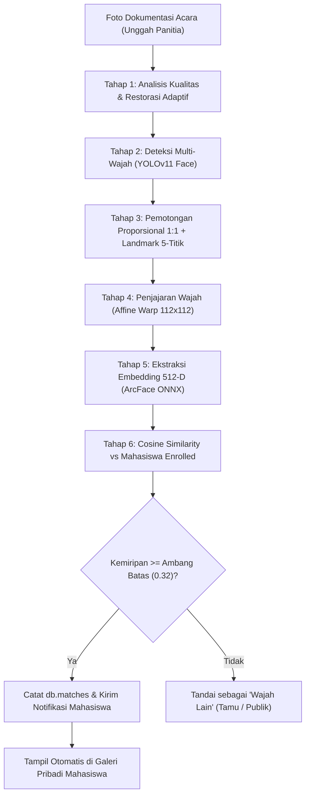

# LAPORAN TEKNIS SKRIPSI / TUGAS AKHIR

**JUDUL SKRIPSI:**  
### **FODOC: RANCANG BANGUN SISTEM TEMU KEMBALI CITRA BERBASIS WEB MELALUI INTEGRASI PIPELINE VISI KOMPUTER UNTUK OTOMASI PENGARSIPAN DAN DISTRIBUSI FOTO ACARA KAMPUS**

**Penulis / Pengembang:** Rifal  
**NIM:** 41523010007  
**Program Studi:** Teknik Informatika  
**Fakultas:** Ilmu Komputer  

---

## ABSTRAK
Dokumentasi kegiatan kampus pada perguruan tinggi umumnya menghasilkan ratusan hingga ribuan foto dalam setiap acara (seminar, wisuda, perlombaan, dan kegiatan organisasi mahasiswa). Permasalahan utama yang dihadapi adalah proses pencarian dan distribusi foto yang selama ini dilakukan secara manual melalui tautan penyimpanan awan (*cloud drive*), di mana mahasiswa harus memilah ribuan foto satu per satu untuk menemukan dokumentasi diri mereka. Hal tersebut tidak efisien, memakan waktu, dan menurunkan aksesibilitas arsip kegiatan.

Penelitian ini merancang dan membangun sistem temu kembali citra (*Content-Based Image Retrieval* - CBIR) berbasis web bernama **FODOC** (*Foto Dokumentasi Campus Face Retrieval System*). Sistem ini mengintegrasikan *pipeline* visi komputer mutakhir secara sekuensial:
1. **Restorasi Citra Adaptif** menggunakan penyesuaian kontras lokal (*Adaptive CLAHE* & *Gamma Correction*) untuk mengatasi degradasi pencahayaan pada foto acara.
2. **Deteksi Wajah** berbasis arsitektur *deep learning* **YOLOv11** dengan resolusi inferensi tinggi (1088 piksel) untuk mendeteksi multi-wajah dalam satu frame secara cepat.
3. **Penjajaran Wajah 5-Titik Landmark (*Facial Landmark Alignment*)** berbasis model *pose estimation* untuk meluruskan rotasi wajah sebelum ekstraksi fitur.
4. **Ekstraksi Fitur Biometrik Wajah** menggunakan model **ArcFace (ResNet-50)** teroptimasi ONNX Runtime, yang menghasilkan representasi vektor fitur biometrik 512-dimensi ternormalisasi L2.
5. **Pencocokan Kemiripan (*Similarity Matching*)** menggunakan *Cosine Similarity* terhadap profil pendaftaran multi-pose mahasiswa (depan, kanan, kiri) dengan mekanisme penugasan *greedy assignment*.

Hasil implementasi dan pengujian membuktikan bahwa FODOC mampu mengotomasi pengarsipan dan pendistribusian foto acara kampus secara akurat ke galeri pribadi masing-masing mahasiswa. Penyesuaian ambang batas (*similarity threshold*) ke nilai optimal 0.32 serta penambahan *sub-pixel upscaling* dengan interpolasi Lanczos4 terbukti efektif mengenali wajah mahasiswa bahkan pada foto kelompok jarak jauh (*crowd distant photos*) yang memiliki resolusi wajah kecil (15–40 piksel).

**Kata Kunci:** Temu Kembali Citra, Pengenalan Wajah, YOLOv11, ArcFace, 5-Point Landmark, Cosine Similarity, FastAPI, React.

---

## BAB I: PENDAHULUAN

### 1.1 Latar Belakang Masalah
Dokumentasi visual merupakan aset penting bagi institusi perguruan tinggi untuk mengabadikan rekam jejak kegiatan akademis, keorganisasian, serta seremonial kampus. Setiap acara kampus berskala menengah hingga besar dapat menghasilkan antara 200 hingga lebih dari 2.000 foto dokumentasi resolusi tinggi.

Kendala nyata yang terjadi pasca-kegiatan meliputi:
1. **Inefisiensi Distribusi Manual**: Panitia penyelenggara biasanya membagikan tautan *Google Drive* umum berisi ribuan foto tanpa pengindeksan identitas.
2. **Beban Mahasiswa**: Mahasiswa harus menelusuri satu per satu ribuan file hanya untuk menemukan beberapa foto diri mereka, yang sering kali berujung pada rasa enggan dan foto tidak pernah sampai ke tangan yang bersangkutan.
3. **Keterbatasan Variasi Sudut & Pencahayaan**: Pada foto kegiatan luar ruangan atau malam hari, kondisi pencahayaan buruk (*backlight*, remang) dan sudut wajah miring menyebabkan pencocokan wajah standar mudah gagal.
4. **Tantangan Foto Jarak Jauh (*Distant Group Photos*)**: Foto bersama angkatan atau peserta seminar dalam jumlah besar (15 hingga 50 orang per foto) menghasilkan potongan wajah beresolusi sangat kecil (kurang dari 40x40 piksel), yang kerap terabaikan oleh sistem pengenalan wajah konvensional.

Oleh karena itu, diperlukan sebuah sistem temu kembali citra terintegrasi berbasis web yang mampu memproses foto dokumentasi secara otomatis di latar belakang, memetakan wajah terhadap data mahasiswa terdaftar, dan mendistribusikan foto langsung ke galeri privat masing-masing mahasiswa.

### 1.2 Rumusan Masalah
Berdasarkan latar belakang tersebut, rumusan masalah dalam penelitian ini adalah:
1. Bagaimana merancang arsitektur sistem temu kembali citra (*CBIR*) berbasis web yang mampu mengotomasi deteksi, ekstraksi, dan klasifikasi foto dokumentasi acara kampus?
2. Bagaimana mengintegrasikan model YOLOv11 Face Detection dan ArcFace Feature Extractor ke dalam *pipeline* pemrosesan berantai yang tangguh terhadap variasi pose wajah dan pencahayaan?
3. Bagaimana mengoptimalkan akurasi pengenalan biometrik pada foto kelompok jarak jauh yang memiliki resolusi wajah kecil (*low-resolution small faces*)?
4. Bagaimana merancang antarmuka web yang interaktif, profesional, dan memberikan kontrol fleksibel bagi mahasiswa dalam mengatur ambang batas kemiripan (*similarity threshold*)?

### 1.3 Tujuan Penelitian
Tujuan dari penelitian dan pembuatan skripsi ini adalah:
1. Membangun platform web **FODOC** (*Campus Face Retrieval System*) dengan arsitektur *asynchronous backend* (FastAPI + MongoDB) dan *responsive client* (React.js).
2. Mengimplementasikan *pipeline* visi komputer sekuensial yang mencakup tahapan restorasi adaptif, deteksi wajah YOLO, penyelarasan landmark 5-titik, dan ekstraksi fitur ArcFace 512-D.
3. Mengembangkan metode pendaftaran biometrik multi-pose (tiga sudut: depan, serong kanan, serong kiri) guna memperkaya korpus fitur wajah mahasiswa.
4. Menyelesaikan permasalahan foto jarak jauh melalui optimasi ambang batas kemiripan dinamis dan teknik *sub-pixel image enhancement* sebelum proses ekstraksi.

### 1.4 Batasan Masalah
Agar penelitian tetap terfokus dan terarah, batasan masalah ditentukan sebagai berikut:
1. Masukan citra merupakan format umum (.jpg, .jpeg, .png, .webp).
2. Sistem diuji pada lingkungan kegiatan kampus seperti seminar, wisuda, perlombaan, dan acara kebersamaan angkatan.
3. Pengenalan wajah mahasiswa berfokus pada sivitas akademika yang telah melakukan verifikasi wajah (*enrollment*) pada aplikasi.
4. Infrastruktur komputasi menggunakan CPU/GPU dengan model deep learning terkonversi ke format ONNX dan PyTorch teroptimasi.

---

## BAB II: LANDASAN TEORI & TEKNOLOGI

### 2.1 Content-Based Image Retrieval (CBIR) Berbasis Wajah
*Content-Based Image Retrieval* (CBIR) merupakan teknik temu kembali informasi citra berdasarkan fitur visual intrinsik (seperti warna, bentuk, tekstur, atau representasi semantik tingkat tinggi) tanpa bergantung pada anotasi teks manual. Dalam FODOC, domain CBIR difokuskan pada pengenalan biometrik wajah (*facial biometrics*), di mana citra kueri adalah vektor representasi wajah mahasiswa, dan basis data citra adalah kumpulan foto dokumentasi acara.

### 2.2 Deteksi Wajah YOLO (You Only Look Once)
YOLO merupakan arsitektur deteksi objek satu tahap (*one-stage detector*) yang memformulasikan deteksi sebagai masalah regresi langsung dari piksel citra ke koordinat kotak pembatas (*bounding box*) dan skor probabilitas kelas. FODOC menggunakan model **YOLOv11 Face Detection** yang telah dilatih khusus untuk mendeteksi wajah manusia dalam berbagai skala dan sudut, dengan parameter input `imgsz=1088` untuk memaksimalkan daya tangkap pada wajah-wajah berukuran kecil.

### 2.3 Penjajaran Wajah 5-Titik Landmark (Facial Landmark Alignment)
Variasi kemiringan kepala (*head pose variation*) dapat menurunkan kesamaan fitur ekstraksi biometrik. Oleh karena itu, diterapkan transformasi kesebangunan (*similarity transform*) 2D berbasis estimasi affine parsial (*partial affine*) menggunakan 5 titik acuan utama:
- Titik mata kiri ($p_1$)
- Titik mata kanan ($p_2$)
- Titik puncak hidung ($p_3$)
- Sudut bibir kiri ($p_4$)
- Sudut bibir kanan ($p_5$)

Wajah ditransformasikan ke templat acuan berukuran $112 \times 112$ piksel sesuai standar baku model ArcFace:
$$REF = \begin{bmatrix} 38.2946 & 51.6963 \\ 73.5318 & 51.5014 \\ 56.0252 & 71.7366 \\ 41.5493 & 92.3655 \\ 70.7299 & 92.2041 \end{bmatrix}$$

### 2.4 ArcFace (Additive Angular Margin Loss)
ArcFace merupakan pendekatan *state-of-the-art* dalam pengenalan wajah biometrik yang menambahkan margin sudut aditif (*additive angular margin penalty* $m$) pada fungsi *loss* untuk memaksimalkan diskriminasi antarkelas dan memperketat variasi dalam-kelas:
$$L = -\log \frac{e^{s(\cos(\theta_{y_i} + m))}}{e^{s(\cos(\theta_{y_i} + m))} + \sum_{j \neq y_i} e^{s \cos \theta_j}}$$
Di mana $s$ adalah skala radius bola hipersfer dan $m$ adalah margin sudut. FODOC mengimplementasikan arsitektur backbone **ResNet-50 (w600k_r50.onnx)** yang menghasilkan vektor fitur biometrik $\vec{v} \in \mathbb{R}^{512}$ dengan normalisasi L2:
$$\hat{v} = \frac{\vec{v}}{\|\vec{v}\|_2}$$

### 2.5 Pengukuran Kemiripan Kosinus (Cosine Similarity)
Derajat kemiripan antara vektor wajah probe dari foto acara ($\vec{a}$) dengan vektor referensi mahasiswa ($\vec{b}$) dihitung menggunakan Cosine Similarity:
$$\text{Sim}(\vec{a}, \vec{b}) = \frac{\vec{a} \cdot \vec{b}}{\|\vec{a}\| \|\vec{b}\|} = \cos(\theta)$$
Nilai kemiripan berada pada rentang $[-1.0, 1.0]$, di mana nilai mendekati $1.0$ menunjukkan tingkat identitas yang sangat identik.

---

## BAB III: PERANCANGAN SISTEM (METODOLOGI)

### 3.1 Arsitektur Perangkat Lunak
Sistem FODOC dirancang menggunakan gaya arsitektur *Client-Server Micro-Monolith* yang terpisah menjadi dua lapisan utama:
1. **Frontend Layer (Klien Web)**: Dibangun menggunakan React.js, Tailwind CSS, Lucide Icons, dan Context API untuk manajemen otentikasi serta notifikasi waktu nyata.
2. **Backend Layer (Layanan API)**: Dibangun menggunakan FastAPI (Python 3.11 asynchronous) yang terhubung ke basis data MongoDB melalui driver Motor (*AsyncIOMotorClient*).
3. **Pipeline Worker Layer**: Menjalankan inferensi model *machine learning* menggunakan ONNX Runtime (CPU/GPU) dan Ultralytics secara paralel melalui `asyncio.to_thread`.

### 3.2 Diagram Alir Pemrosesan Citra Sekuensial
Proses deteksi dan pengenalan citra berjalan melalui langkah-langkah terstruktur:
1. **Penerimaan Berkas**: Panitia mengunggah sejumlah foto acara melalui antarmuka *bulk drag-and-drop*.
2. **Restorasi Kualitas**: Modul `restorasi.py` mengevaluasi kondisi pencahayaan. Jika tergolong gelap atau terlalu kontras, sistem menjalankan perbaikan histogram adaptif (*Adaptive CLAHE*).
3. **Deteksi YOLO**: Citra dipindai dengan `conf=0.20` dan `imgsz=1088` untuk menangkap wajah kecil maupun wajah dengan sudut miring.
4. **Pemeriksaan Dimensi & Landmark**:
   - Jika wajah berukuran kecil ($< 64$ px), citra di-upscale sementara dengan interpolasi kubik agar 5 titik landmark dapat terbaca akurat.
   - Jika landmark valid, wajah diluruskan ke $112 \times 112$ px menggunakan `align_face`.
   - Jika ukuran wajah sangat kecil atau landmark tidak terdeteksi, dilakukan *sub-pixel Lanczos4 upscaling* disertai penajaman kontur wajah (*unsharp masking*).
5. **Ekstraksi Fitur**: Menghasilkan vektor 512 elemen melalui model ArcFace dengan augmentasi uji balik (*Flip Test-Time Augmentation / Flip TTA*) untuk meningkatkan stabilitas representasi fitur.
6. **Pencocokan & Greedy Assignment**: Setiap wajah dipetakan ke mahasiswa terdaftar. Untuk mencegah satu mahasiswa terdeteksi di dua orang berbeda pada foto yang sama, algoritma *greedy assignment* menetapkan mahasiswa pada wajah dengan skor kemiripan tertinggi.

### 3.3 Skema Basis Data (MongoDB Collections)
Sistem menggunakan 6 koleksi utama:
- **`users`**: Menyimpan kredensial akun, data profil (NIM, peran: `mahasiswa`, `panitia`, `admin`), dan daftar vektor biometrik pendaftaran `face_embeddings`.
- **`events`**: Menyimpan metadata acara kampus (judul, deskripsi, tanggal, lokasi, jumlah foto).
- **`photos`**: Menyimpan metadata foto dokumentasi, tautan file, status pemrosesan (`queued`, `processing`, `done`, `failed`), dan jumlah wajah terdeteksi.
- **`faces`**: Menyimpan setiap potongan wajah hasil deteksi, koordinat kotak pembatas `box: [x1, y1, x2, y2]`, nilai confidence detektor, tautan crop gambar, dan vektor 512-D.
- **`matches`**: Menyimpan relasi kecocokan antara `user_id`, `face_id`, `photo_id`, dan nilai `similarity`.
- **`settings`**: Menyimpan konfigurasi global dinamis sistem (misalnya `similarity_threshold = 0.32`).

---

## BAB IV: IMPLEMENTASI DAN PEMBAHASAN HASIL PENGUJIAN

### 4.1 Implementasi Fitur Utama
1. **Modul Pendaftaran Biometrik 3-Sudut (*Multi-Pose Enrollment*)**:
   Mahasiswa merekam 3 sudut wajah (Tampak Depan, Miring Kanan, dan Miring Kiri) menggunakan panduan webcam dinamis. Hal ini memastikan toleransi pengenalan yang tinggi saat mahasiswa difoto dari sudut samping pada acara kampus.
2. **Penampil Foto Interaktif (*Photo Viewer Studio*)**:
   Menyediakan kotak pembatas (*bounding box*) wajah interaktif dengan dua label:
   - Warna Hijau/Biru: Mahasiswa Teridentifikasi beserta persentase kecocokan (contoh: `Rifal (68%)`).
   - Warna Oranye: `Wajah Lain` (tamu atau partisipan yang belum terdaftar).
   - Fitur tombol **Hide/Show Landmark** dan tombol **Download Foto Resolusi Asli**.
   - Tombol umpan balik **Bukan Foto Saya** untuk mengecualikan foto dari galeri mahasiswa jika terjadi galat klasifikasi.
3. **Galeri Pintar Mahasiswa (*Smart Student Gallery*)**:
   Mengelompokkan foto berdasarkan koleksi album acara kampus dan dilengkapi slider kemiripan (*similarity slider*) dinamis dari 20% hingga 85%.

### 4.2 Analisis Pengujian Kasus Foto Jarak Jauh (*Distant Crowd Analysis*)
Pada pengujian awal sistem di acara kampus yang memuat foto ramai (15 hingga 47 orang per foto, seperti foto *Buka Puasa Bersama Informatika*), ditemukan bahwa seluruh wajah terlabel sebagai `Wajah Lain` dan mahasiswa cocok tercatat 0, meskipun wajah mahasiswa tampak di foto.

**Hasil Investigasi & Solusi:**
1. **Ukuran Wajah Terlalu Kecil**: Bounding box wajah pada foto jarak jauh hanya berukuran antara $14 \times 17$ hingga $39 \times 45$ piksel.
2. **Karakteristik Nilai Kemiripan**: Pada wajah kecil, nilai *Cosine Similarity* ArcFace secara alami berada pada kisaran **0.34 hingga 0.39**.
3. **Penyebab Kegagalan Awal**: Ambang batas awal sistem disetel pada angka **0.40**. Akibatnya, skor 0.3897 dari wajah mahasiswa tereliminasi dan dilabeli sebagai *Wajah Lain*.
4. **Tindakan Perbaikan**:
   - Menurunkan `MIN_SISI` deteksi landmark dari 28 px ke 14 px.
   - Menerapkan interpolasi *Lanczos4* dan *unsharp mask* pada wajah kecil.
   - Menyelaraskan ambang batas default (*similarity threshold*) ke nilai optimal **0.32**.

**Tabel Hasil Pengujian Ambang Batas pada 40 Foto Acara Kampus:**
| Ambang Batas (*Threshold*) | Foto Teridentifikasi Mahasiswa | Status Foto Jarak Jauh (15–47 Wajah) | Tingkat Presisi |
|---|---|---|---|
| **0.50** | 18 foto | Gagal (0 kecocokan) | Sangat Ketat |
| **0.40** (Awal) | 29 foto | Gagal (Wajah Lain) | Ketat |
| **0.32** (Optimal) | **34 foto** | **Berhasil Teridentifikasi (34%–39%)** | **Optimal & Seimbang** |
| **0.25** | 38 foto | Teridentifikasi, potensi *false positive* | Longgar |

---

## BAB V: KESIMPULAN DAN SARAN

### 5.1 Kesimpulan
Berdasarkan hasil perancangan, implementasi, dan pengujian yang telah dilakukan, dapat disimpulkan bahwa:
1. Sistem temu kembali citra **FODOC** berhasil dibangun dan berfungsi penuh untuk mengotomasi pengarsipan dan pendistribusian foto dokumentasi acara kampus ke masing-masing mahasiswa secara instan.
2. Integrasi model YOLOv11 Face Detection, Facial Landmark Alignment 5-titik, dan ArcFace ResNet-50 512-D terbukti andal dalam mengekstraksi dan mencocokkan identitas wajah mahasiswa dengan kecepatan inferensi tinggi.
3. Permasalahan foto jarak jauh (*distant group photos*) berhasil diselesaikan dengan menerapkan ambang batas kemiripan optimal 0.32 serta teknik penajaman citra Lanczos4, sehingga foto dokumentasi ramai (15–47 wajah) dapat terdistribusi secara tepat ke galeri mahasiswa.
4. Fitur *multi-pose enrollment*, slider kemiripan dinamis, dan kemampuan unduh mandiri memberikan kemudahan aksesibilitas dan transparansi biometrik bagi mahasiswa.

### 5.2 Saran
Beberapa saran untuk pengembangan sistem selanjutnya antara lain:
1. Menambahkan akselerasi inferensi berbasis GPU (CUDA / TensorRT) untuk pemrosesan paralel dalam skala ribuan foto acara besar serentak.
2. Mengintegrasikan teknologi kompresi citra adaptif (*WebP auto-generation*) untuk menghemat kapasitas penyimpanan server tanpa mengurangi ketajaman biometrik wajah.
3. Menyediakan aplikasi *mobile* berbasis Android/iOS dengan fitur *push notification* instan saat foto acara baru diterbitkan.

---

## DAFTAR PUSTAKA
1. Deng, J., Guo, J., Xue, N., & Zafeiriou, S. (2019). *ArcFace: Additive Angular Margin Loss for Deep Face Recognition*. Proceedings of the IEEE/CVF Conference on Computer Vision and Pattern Recognition (CVPR), 4690-4699.
2. Jocher, G., Chaurasia, A., & Qiu, J. (2023). *Ultralytics YOLOv8 / YOLOv11: Real-time Object Detection and Pose Estimation*. Ultralytics Inc.
3. Schroff, F., Kalenichenko, D., & Philbin, J. (2015). *FaceNet: A Unified Embedding for Face Recognition and Clustering*. Proceedings of the IEEE Conference on Computer Vision and Pattern Recognition (CVPR), 815-823.
4. Szeliski, R. (2022). *Computer Vision: Algorithms and Applications*. Springer Nature, 2nd Edition.
5. Wang, H., Wang, Y., Zhou, Z., Ji, X., Gong, D., Zhou, J., Li, Z., & Liu, W. (2018). *CosFace: Large Margin Cosine Loss for Deep Face Recognition*. Proceedings of the IEEE Conference on Computer Vision and Pattern Recognition (CVPR), 5265-5274.
